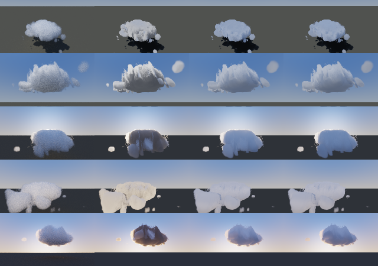
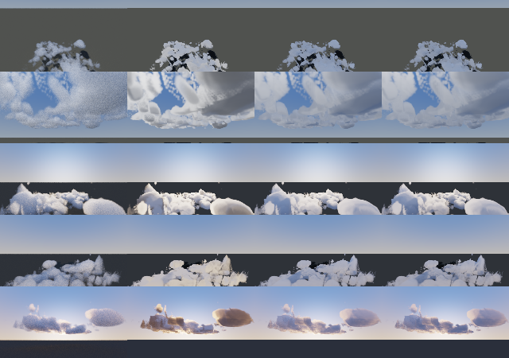

# Round three: cloud shapes from an LES, lighting retrained

Shape reference: `les_cumulus.py` (moist Boussinesq LES, numpy: saturation adjustment, Smagorinsky mixing, semi-Lagrangian MacCormack advection, FFT projection; BOMEX-like trade cumulus at 50 m and a deeper congestus case at 100 m), `les_stats.py` (statistics computed the same way on the LES and on fields exported from the game), `les_fit.py` (width-profile fit). Lighting: the round-two pipeline on two new fields exported after the shape rework (`scattered3`, `broken3`).

## Shape statistics

Width profile = mean cloud radius / the cloud's largest radius in 10 height bins (base -> top), volume weighted. Lean = slope of the cloud centroid with height (m/m). Top spectrum = slope of the horizontal power spectrum of cloud-top height (-5/3 = Kolmogorov). Game fields on a 30 m grid (density > 0.05), small fragments included.

| field | cover | width profile (base .. top) | base spread (m) | lean (m/m) | size slope | top spectrum |
|---|---|---|---|---|---|---|
| LES shallow cumulus (50 m) | 0.10 | 0.58 0.73 0.71 0.72 0.72 0.74 0.77 0.83 0.81 0.55 | 30 | +0.73 (abs 0.79) | -2.17 | -1.08 |
| LES congestus (100 m) | 0.14 | 0.47 0.66 0.74 0.81 0.85 0.86 0.87 0.84 0.75 0.49 | 38 | +0.81 (abs 0.87) | -4.02 | -0.93 |
| game round two, scattered | 0.41 | 0.91 0.99 0.97 0.88 0.78 0.65 0.54 0.39 0.27 0.15 | 30 | -0.06 (abs 0.40) | -1.58 | -1.80 |
| game round three, scattered | 0.46 | 0.76 0.96 0.99 0.98 0.97 0.92 0.88 0.82 0.69 0.46 | 22 | +0.28 (abs 0.33) | -1.49 | -1.63 |
| game round two, broken | 0.60 | 0.75 0.91 0.82 0.78 0.72 0.63 0.50 0.33 0.21 0.08 | 28 | -0.19 (abs 0.42) | -1.56 | -1.84 |
| game round three, broken | 0.58 | 0.57 0.94 0.94 0.85 0.75 0.59 0.41 0.30 0.20 0.09 | 23 | +0.13 (abs 0.30) | -1.89 | -1.55 |

LES: lean / shear = 520 s (shallow) and 390 s (congestus). Fitted profile g(h) (les_fit.py): congestus gb 0.40, hp 0.70, k 4, p 0.40 (rms 0.009); the 50 m shallow run is resolution-limited (median cloud 5 cells across) and was not used as is.

## Point-wise accuracy on the new fields (ln RMSE, importance weighted; bias = mean ratio)

| field | classic J | round-two J | round-three J (field held out) | round-three J (all fields) | round-two Vsky / Vground | round-three Vsky / Vground |
|---|---|---|---|---|---|---|
| scattered3 | 1.42 (bias 2.01) | 1.00 (1.09) | 0.98 (1.03) | 0.85 (1.00) | 0.35 / 0.34 | 0.33 / 0.30 |
| broken3 | 1.28 (bias 2.38) | 0.88 (1.27) | 0.91 (1.36) | 0.84 (1.20) | 0.41 / 0.35 | 0.39 / 0.32 |

## Images on the new fields

Models: classic; r2 = round-two networks as shipped; v2 = round-three networks (now in src/neural/weights-light.js).

### scattered3

| case | model | bias | relMAE | lnRMSE | contrast | chroma |
|---|---|---|---|---|---|---|
| noon_above | classic | 1.067 | 0.268 | 0.383 | 0.812 | 0.079 |
|  | r2 | 0.892 | 0.273 | 0.343 | 0.705 | 0.070 |
|  | v2 | 0.887 | 0.265 | 0.330 | 0.712 | 0.070 |
| noon_below | classic | 1.068 | 0.364 | 0.421 | 1.677 | 0.105 |
|  | r2 | 0.983 | 0.136 | 0.154 | 0.891 | 0.053 |
|  | v2 | 0.975 | 0.128 | 0.144 | 0.867 | 0.051 |
| low_toward | classic | 0.666 | 0.689 | 0.608 | 1.190 | 0.136 |
|  | r2 | 0.885 | 0.460 | 0.308 | 0.911 | 0.064 |
|  | v2 | 0.807 | 0.419 | 0.260 | 0.904 | 0.084 |
| low_away | classic | 1.354 | 0.399 | 0.507 | 0.647 | 0.147 |
|  | r2 | 0.984 | 0.186 | 0.273 | 0.627 | 0.049 |
|  | v2 | 0.977 | 0.189 | 0.276 | 0.625 | 0.045 |
| sunset_base | classic | 0.808 | 0.339 | 0.653 | 1.368 | 0.169 |
|  | r2 | 0.976 | 0.153 | 0.230 | 0.888 | 0.051 |
|  | v2 | 0.928 | 0.168 | 0.231 | 0.913 | 0.063 |

### broken3

| case | model | bias | relMAE | lnRMSE | contrast | chroma |
|---|---|---|---|---|---|---|
| noon_above | classic | 1.516 | 0.537 | 0.523 | 0.991 | 0.044 |
|  | r2 | 1.075 | 0.216 | 0.266 | 0.869 | 0.062 |
|  | v2 | 1.046 | 0.206 | 0.255 | 0.869 | 0.049 |
| noon_below | classic | 1.239 | 0.464 | 0.466 | 2.268 | 0.117 |
|  | r2 | 0.959 | 0.150 | 0.193 | 1.280 | 0.053 |
|  | v2 | 0.948 | 0.152 | 0.194 | 1.268 | 0.056 |
| low_toward | classic | 1.512 | 0.613 | 0.578 | 1.165 | 0.109 |
|  | r2 | 1.272 | 0.326 | 0.410 | 0.918 | 0.055 |
|  | v2 | 1.135 | 0.238 | 0.337 | 0.888 | 0.049 |
| low_away | classic | 1.808 | 0.809 | 0.661 | 0.892 | 0.170 |
|  | r2 | 1.228 | 0.260 | 0.322 | 0.823 | 0.032 |
|  | v2 | 1.167 | 0.218 | 0.287 | 0.824 | 0.037 |
| sunset_base | classic | 0.824 | 0.334 | 0.504 | 1.307 | 0.184 |
|  | r2 | 0.896 | 0.211 | 0.261 | 0.917 | 0.078 |
|  | v2 | 0.814 | 0.241 | 0.311 | 0.953 | 0.069 |

